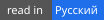
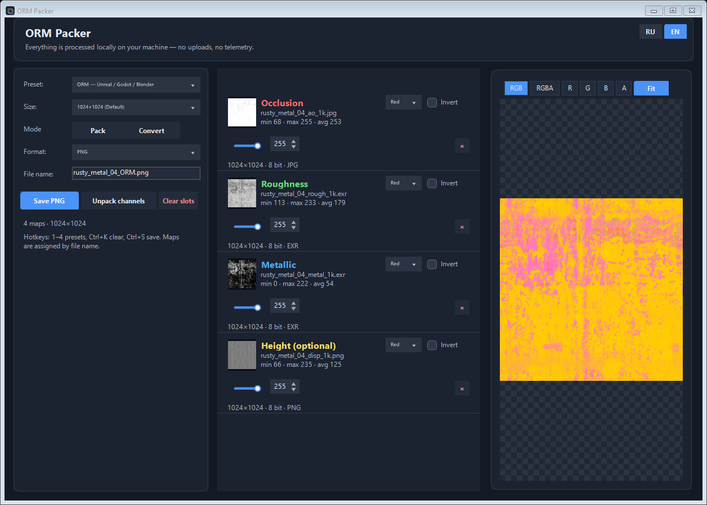
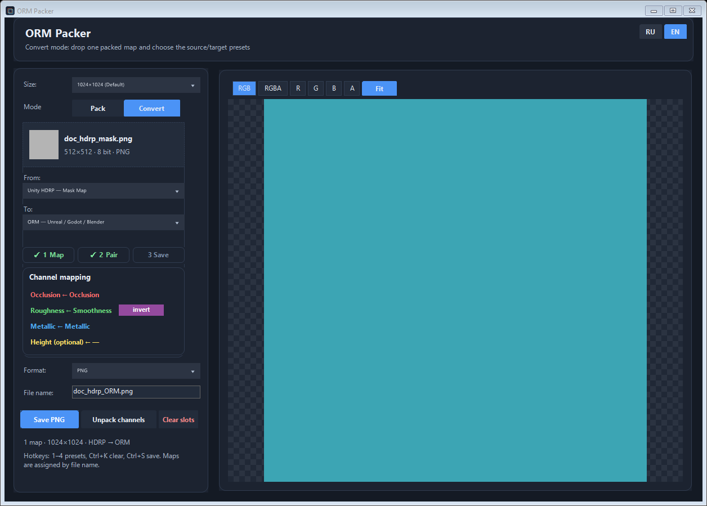

# ORM Packer

[](README.ru.md) · [Web app](https://kiyzo.github.io/orm-packer/)

   

ORM Packer turns separate PBR masks (AO, Roughness, Metallic, optional Height or Detail Mask) into one packed texture for a game engine. It runs entirely on your machine or in your browser — no uploads, no account, no telemetry. The Windows app, the web app and the CLI share the same core.

 

## Get it

- **Browser:** [kiyzo.github.io/orm-packer](https://kiyzo.github.io/orm-packer/) — nothing to install.
- **Windows:** `./publish.ps1` → `publish/OrmPacker.exe` (~28 MB, needs the .NET 8 Desktop Runtime). For an exe that needs no .NET install: `./publish.ps1 -SelfContained` (~189 MB) or add `-Compressed` (~83 MB).
- **From source:** `dotnet run -c Release --project OrmPacker/OrmPacker.csproj`.

`./build.ps1` builds the desktop app, tests and web app into `publish/`. Launch only `publish/OrmPacker.exe`.

## Settings and why they matter

| Setting | What to choose | Why |
| --- | --- | --- |
| Preset | ORM, Unity HDRP, Unity URP/Built-in or Custom | Engines read the packed channels differently. Pick the layout your engine expects. |
| Size | Original, 8192…64 (default 1024) | `Original` uses the largest input map and keeps its aspect ratio. Smaller sizes save memory and disk space. |
| Invert | On/off per channel | Roughness and Smoothness are opposites: switching ORM ↔ HDRP inverts the value automatically (`255 - v`). No gamma conversion is applied. |
| Constant | 0–255 for an empty slot | Lets you fill a channel with a fixed value instead of a texture. |
| Format | PNG, JPEG, TGA, BMP | PNG is lossless and recommended for masks. JPEG is for previews only. Output is always **8 bits per channel**: masks are data, not color. |

Channel layouts:

| Preset | R | G | B | A |
| --- | --- | --- | --- | --- |
| ORM (Unreal / Godot / Blender / glTF) | Occlusion | Roughness | Metallic | Height (optional) |
| Unity HDRP — Mask Map | Metallic | Occlusion | Detail Mask | Smoothness |
| Unity URP / Built-in | Metallic | Metallic | Metallic | Smoothness |
| Custom | arbitrary | arbitrary | arbitrary | arbitrary |

Import the result as **non-color data**: Unreal → `Masks (no sRGB)`; Unity HDRP → *Mask Map* with sRGB off; Unity URP/Built-in → *Metallic* with `Smoothness Source = Metallic Alpha`; Blender → `Non-Color` + `Separate Color` (G = Roughness, B = Metallic); Godot → `ORMMaterial3D`, ORM slot. A color-managed import would change mask values.

## Pack

1. Choose a preset and a size.
2. Drop the maps onto the window or into individual slots. Names such as `_AO`, `_Roughness`, `_Metallic`, `_Smoothness`, `_Height` and `_Detail` are detected automatically; normal maps are skipped and unknown maps go to a free slot with a hint.
3. Press **Save** or `Ctrl+S`. The file name is suggested from the shared part of the input names; editing the name field disables auto-naming.

The **Output** block previews RGB/RGBA/R/G/B/A and **Fit** (1:1). **Unpack channels** saves the current result as four full-size grayscale PNGs. Hotkeys: `1`–`4` select presets, `Ctrl+K` clears slots. The app restores the last preset, size, format and slot settings from `%LOCALAPPDATA%\OrmPacker\session.json`.

## Convert

Repack one already-packed map into another preset — three steps, no manual channel juggling.

1. Switch the mode in the header and drop a map onto the source card (or click the card to pick a file).
2. Choose **From** and the target **Preset**.
3. Check the **Channel mapping** panel and press **Save**.

The mapping comes from the presets in the shared core; the preview, name and steps update as you change the pair. Session, preview tabs and full-resolution unpacking work the same way as in Pack mode.

## CLI

```powershell
./publish/OrmPacker.exe pack --preset orm --ao ao.png --rough rough.png --metal metal.png --out ORM.png
./publish/OrmPacker.exe convert --from hdrp --to orm --in MaskMap.png --out ORM.png
./publish/OrmPacker.exe batch --in ./sets --out ./packed --preset orm
./publish/OrmPacker.exe unpack --in MaskMap.png --out ./channels --name T_Rock
./publish/OrmPacker.exe --help
```

`--size` and `--format` are optional; `batch` treats each subdirectory as a set. Exit codes: `0` success, `1` error, `2` usage. Passing ordinary files without a command opens the GUI.

## Formats and limits

- **Desktop input:** PNG/APNG (first frame), JPG, BMP, GIF, TIFF, ICO, TGA (8/16/24/32 bpp, palette, RLE) and EXR, including DWAA. WebP/AVIF/HEIC/SVG are not supported.
- **Web input:** PNG, JPG, BMP, GIF, WebP, TGA and EXR (single-part scanline). TIFF and ICO are not decoded. Previews are capped at 1024 px; the full-size pack runs on export. Very large outputs depend on browser memory. The web app is served at `/orm-packer/` only.
- **Output:** PNG (lossless), JPEG (quality 92), TGA and BMP, RGB or RGBA. Identical inputs always produce byte-identical files; PNG carries no sRGB/gAMA/timestamp chunks.
- **SmartScreen:** release exes are self-signed, so Windows may warn on first run. Import `orm-packer-local.cer` into *Current User → Trusted Root Certification Authorities* and *Trusted Publishers* on that PC (`./trust-cert.ps1` opens the import wizard). A self-signed certificate does not replace a trusted CA certificate.

To run the web app locally:

```powershell
dotnet run -c Release --project web/OrmPacker.Web/OrmPacker.Web.csproj -- --pathbase /orm-packer
# http://localhost:5000/orm-packer/
```

