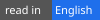
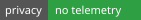
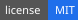
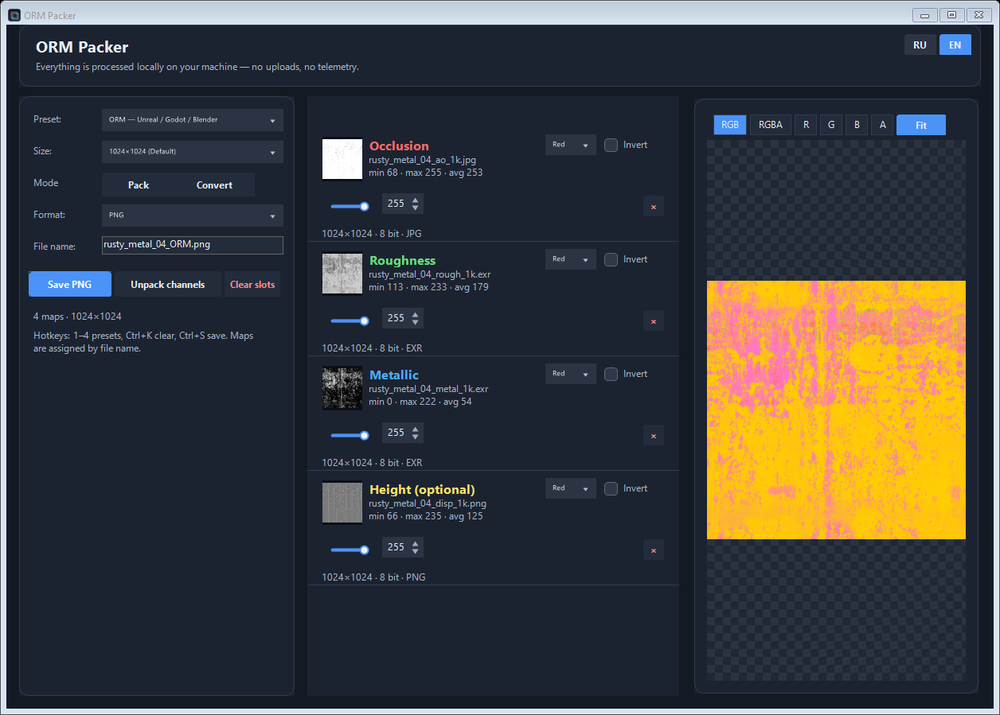
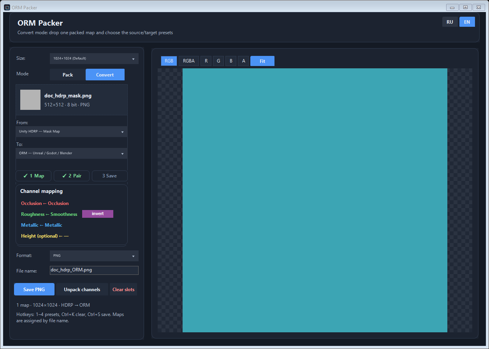

# ORM Packer

[](README.md) · [Web-версия](https://kiyzo.github.io/orm-packer/)

   

ORM Packer собирает отдельные PBR-маски (AO, Roughness, Metallic, при необходимости Height или Detail Mask) в одну упакованную текстуру для игрового движка. Вся обработка идёт локально — на компьютере или в браузере: без загрузки в облако, аккаунта и телеметрии. Windows-приложение, веб-версия и CLI используют одно ядро.

 

## Как получить

- **В браузере:** [kiyzo.github.io/orm-packer](https://kiyzo.github.io/orm-packer/) — установка не нужна.
- **Для Windows:** `./publish.ps1` → `publish/OrmPacker.exe` (~28 МБ, нужен .NET 8 Desktop Runtime). Для exe без установки .NET: `./publish.ps1 -SelfContained` (~189 МБ) или с `-Compressed` (~83 МБ).
- **Из исходников:** `dotnet run -c Release --project OrmPacker/OrmPacker.csproj`.

`./build.ps1` собирает десктоп, тесты и веб в `publish/`. Запускать следует только `publish/OrmPacker.exe`.

## Настройки и зачем они нужны

| Настройка | Что выбрать | Почему |
| --- | --- | --- |
| Пресет | ORM, Unity HDRP, Unity URP/Built-in или Custom | Движки читают каналы по-разному — нужен тот порядок, который ждёт движок. |
| Размер | Original, 8192…64 (по умолчанию 1024) | `Original` берёт самую большую входную карту и сохраняет пропорции. Меньший размер экономит память и место. |
| Инверсия | Вкл/выкл для канала | Roughness и Smoothness — противоположности: при смене ORM ↔ HDRP значение инвертируется автоматически (`255 - v`). Гамма-преобразований нет. |
| Константа | 0–255 для пустого слота | Позволяет записать в канал фиксированное значение вместо текстуры. |
| Формат | PNG, JPEG, TGA, BMP | PNG без потерь — рекомендуется для масок; JPEG только для предпросмотров. Выход всегда **8 бит на канал**: маски — данные, а не цвет. |

Раскладка каналов:

| Пресет | R | G | B | A |
| --- | --- | --- | --- | --- |
| ORM (Unreal / Godot / Blender / glTF) | Occlusion | Roughness | Metallic | Height (необязательно) |
| Unity HDRP — Mask Map | Metallic | Occlusion | Detail Mask | Smoothness |
| Unity URP / Built-in | Metallic | Metallic | Metallic | Smoothness |
| Custom | произвольно | произвольно | произвольно | произвольно |

Импортируйте результат как **данные без цветокоррекции**: Unreal → `Masks (no sRGB)`; Unity HDRP → слот *Mask Map* с выключенным sRGB; Unity URP/Built-in → *Metallic* и `Smoothness Source = Metallic Alpha`; Blender → `Non-Color` + `Separate Color` (G = Roughness, B = Metallic); Godot → `ORMMaterial3D`, слот ORM. Цветовое преобразование при импорте испортит значения масок.

## Упаковка

1. Выберите пресет и размер.
2. Перетащите карты в окно или в конкретные слоты. Имена вида `_AO`, `_Roughness`, `_Metallic`, `_Smoothness`, `_Height`, `_Detail` распознаются автоматически; normal-карты пропускаются, неизвестные карты попадают в свободный слот с подсказкой.
3. Нажмите **Сохранить** или `Ctrl+S`. Имя файла подставляется из общей части имён входных карт; ручная правка поля отключает автоподстановку.

Блок **Output** показывает RGB/RGBA/R/G/B/A и **Fit** (1:1). **Распаковать каналы** сохраняет текущий результат в четыре полноразмерных grayscale PNG. Горячие клавиши: `1`–`4` — пресеты, `Ctrl+K` — очистка слотов. Настройки восстанавливаются из `%LOCALAPPDATA%\OrmPacker\session.json`.

## Конвертация

Переупаковывает готовую карту в другой пресет за три шага, без ручного переноса каналов.

1. Включите режим в шапке и бросьте карту на карточку-источник (или кликните по ней, чтобы выбрать файл).
2. Выберите **Из** и целевой **Пресет**.
3. Проверьте панель **Маппинг каналов** и нажмите **Сохранить**.

Маппинг строится из пресетов общего ядра; превью, имя и индикатор шагов обновляются при смене пары. Сессия, вкладки превью и распаковка в полном размере работают так же, как в режиме упаковки.

## CLI

```powershell
./publish/OrmPacker.exe pack --preset orm --ao ao.png --rough rough.png --metal metal.png --out ORM.png
./publish/OrmPacker.exe convert --from hdrp --to orm --in MaskMap.png --out ORM.png
./publish/OrmPacker.exe batch --in ./sets --out ./packed --preset orm
./publish/OrmPacker.exe unpack --in MaskMap.png --out ./channels --name T_Rock
./publish/OrmPacker.exe --help
```

`--size` и `--format` необязательны; `batch` считает каждый подкаталог набором. Коды возврата: `0` — успех, `1` — ошибка, `2` — usage. Запуск с обычными файлами без команды открывает GUI.

## Форматы и ограничения

- **Десктоп:** PNG/APNG (первый кадр), JPG, BMP, GIF, TIFF, ICO, TGA (8/16/24/32 бпп, палитра, RLE) и EXR, включая DWAA. WebP/AVIF/HEIC/SVG не поддерживаются.
- **Веб:** PNG, JPG, BMP, GIF, WebP, TGA и EXR (single-part scanline). TIFF и ICO не декодируются. Превью ограничено 1024 px, полная сборка выполняется при экспорте; большие размеры зависят от памяти браузера. Приложение доступно только по пути `/orm-packer/`.
- **Выход:** PNG (без потерь), JPEG (качество 92), TGA и BMP, RGB или RGBA. Одинаковые входы дают побайтово одинаковый файл; PNG не содержит sRGB/gAMA/tIME.
- **SmartScreen:** релизные exe подписаны самоподписанным сертификатом, поэтому Windows может предупредить при первом запуске. Импортируйте `orm-packer-local.cer` в *Текущий пользователь → Доверенные корневые центры сертификации* и *Доверенные издатели* (`./trust-cert.ps1` откроет мастер). Самоподписанный сертификат не заменяет сертификат доверенного CA.

Локальный запуск веб-версии:

```powershell
dotnet run -c Release --project web/OrmPacker.Web/OrmPacker.Web.csproj -- --pathbase /orm-packer
# http://localhost:5000/orm-packer/
```

